# 2D Trail Effects Lab — snow, grass and water trails

[日本語](README.md) | **English**

▶ **Play in your browser: https://kumi0708.github.io/2d-trail-effects-lab/**

| ❄ Snow dents | 🌾 Grass flattens and springs back | 💧 Ripples only on landing |
|---|---|---|
| 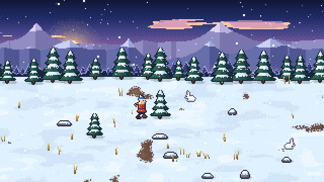 | 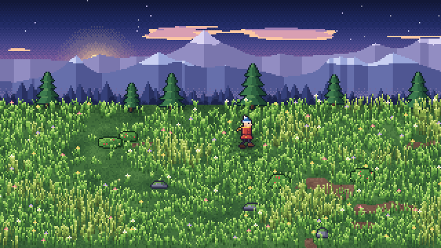 | 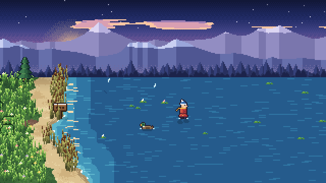 |

One small **trail canvas** (an 8-bit grayscale render texture) drives three ground effects at once.
This is a plain-JavaScript re-implementation (Canvas 2D plus a hand-written pixel buffer, no engine) of the technique in SpriteCook's article [*2D trail render texture: snow, grass, water*](https://www.spritecook.ai/blog/2d-trail-render-texture-snow-grass-water).
All art (terrain, sky, character, trees, animals) is generated in code. There are no image assets.

## Controls

| Input | Action |
|---|---|
| `←↑↓→` / `WASD` | Walk (turns autopilot off) |
| Click / drag | Poke the ground (stamps a dot there) |
| `P` | Autopilot on/off |
| `M` | Overlay the trail canvas on the ground in red |
| `F` | Snowfall on/off |
| `R` | Reset trails, waves and grass |
| `1` `2` `3` | Warp to snowfield / meadow / lake |
| Slider | Fade per frame (the article uses 3; this demo starts at 2) |

The live trail canvas and water height field are shown below the game.
There is no build step: open `index.html`, or serve the folder with any static server such as `python3 -m http.server`.

---

# How it works (illustrated)

> Every figure in this README was exported from the real simulation by [`tools/figures.js`](tools/figures.js).

## Overview

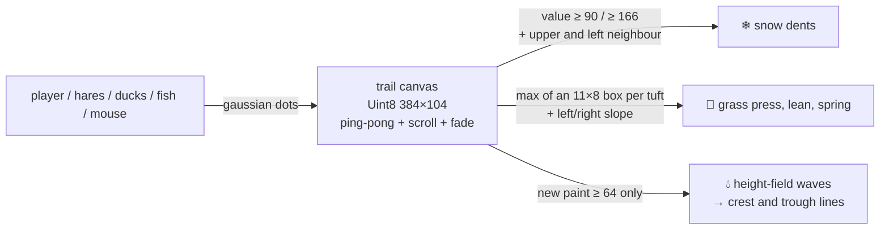

- Everything is drawn by hand into a **320×180** pixel buffer and scaled up by an integer factor with CSS `image-rendering: pixelated`.
- The simulation runs at a **fixed 30 fps**, because the article's numbers are per 30 fps frame. Drawing uses `requestAnimationFrame`.
- All game code is in one file, [`src/main.js`](src/main.js).

---

## 1. The trail canvas: one image behind everything

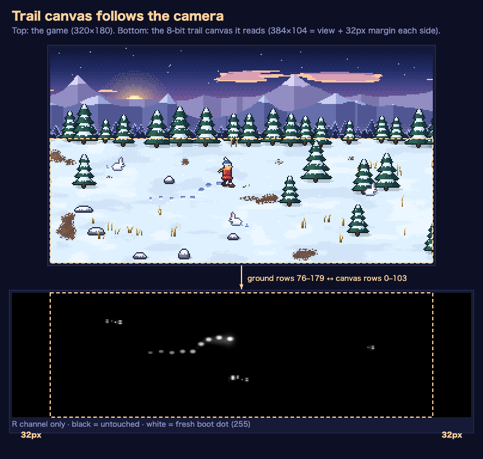

The game (top) and the canvas it updates every frame (bottom).
The canvas is **320 px of view + 32 px margin on each side = 384 px** wide and 104 px tall (the ground). One canvas pixel is one world pixel, and brighter means stepped on harder.

| Item | Detail |
|---|---|
| Format | `Uint8Array`, values 0–255 (the R channel of an RGBA8 target on the GPU) |
| Double buffer | `trailA` / `trailB` ping-pong, mirroring the GPU rule that a shader can't read the texture it writes |
| Fade | `v = max(v − FADE, 0)` each frame, in whole 8-bit levels |
| Combining | gaussian stamps are **max-combined** (the brighter value wins; nothing is added) |
| New paint | `newPaint = written − faded`: what was painted *this frame*. Only water uses it |

### Scrolling with the camera

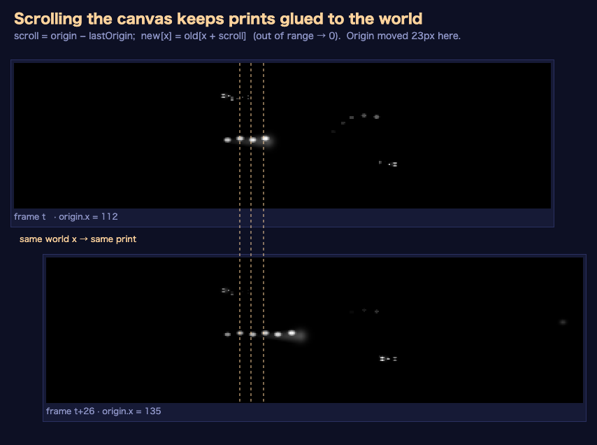

The canvas moves with the camera, but footprints must stay glued to the world.
Each frame, `scroll = origin − lastOrigin` (whole pixels), and **the new canvas reads the old one at `x + scroll`** (0 when out of range).
The two canvases above are 26 frames apart. The origin moved 23 px, yet the dashed lines show the same prints at the same world x.

### Two stamps, many thresholds

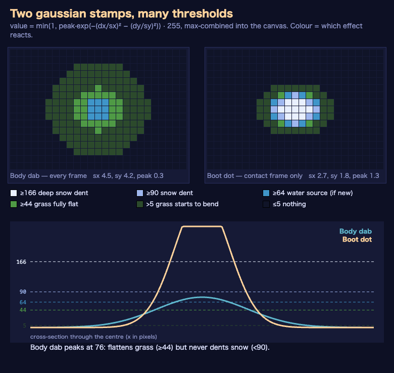

| Stamp | When | sx, sy | peak |
|---|---|---|---|
| Body dab | **every frame**, at feet + (facing×1, 1) | 4.5, 4.2 | 0.30 → max level 76 |
| Boot | only on the frame the walk cycle **enters** a contact frame | 2.7, 1.8 | 1.3 → flat white centre |

Each effect reads the same canvas through a different threshold.
The body dab peaks at 76, so it **fully flattens grass (≥ 44) but never dents snow (< 90)**: you leave footprints, not a trench.

### Walk cycle and boot dots

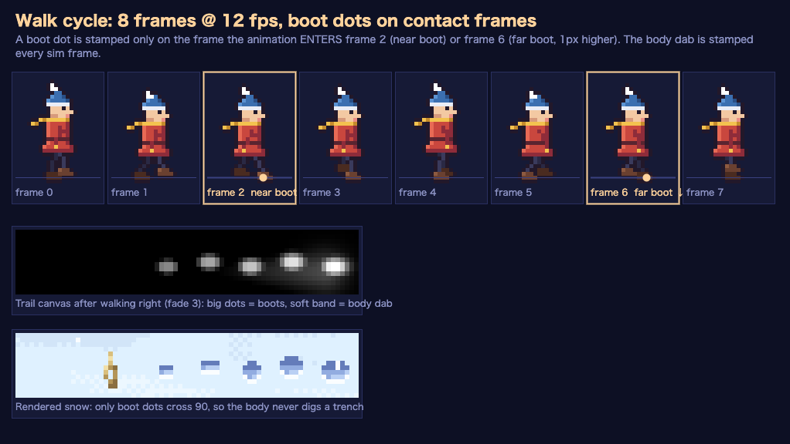

The walk is 8 frames at 12 fps. A boot dot is stamped once, on the frame the animation **enters** frame 2 (near boot) or frame 6 (far boot, 1 px higher).
The two strips below come from an actual walk: only the boot dots cross the snow threshold of 90, and the body dab leaves just a faint band.

---

## 2. Snow: depth from thresholds and two neighbours

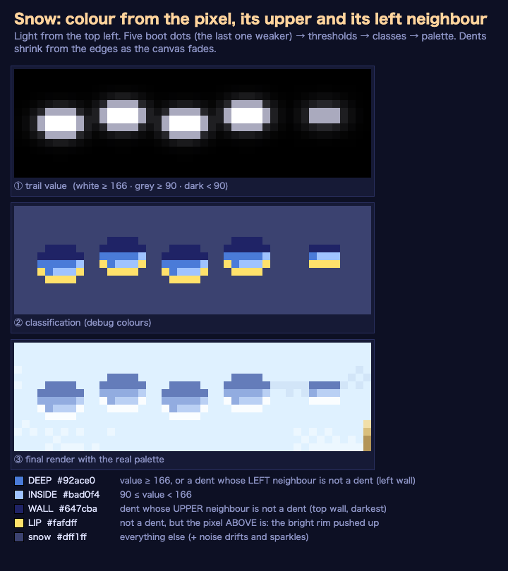

Each pixel's colour depends only on **its own value, the value above it and the value to its left** (light comes from the top left).

| Condition | Colour |
|---|---|
| value ≥ 166 | DEEP `#92ace0` (deep dent) |
| 90 ≤ value < 166 | INSIDE `#bad0f4` (shallow dent) |
| dent, left neighbour isn't a dent | DEEP (left wall shade) |
| deep dent, upper neighbour is a shallow dent | WALL `#647cba` |
| dent, upper neighbour isn't a dent | WALL (top wall, the darkest shadow) |
| not a dent, but the pixel above is | LIP `#fafdff` (bright rim pushed up below the dent) |
| otherwise | snow `#dff1ff` (+ noise drifts and sparkles) |

Panel ② shows the classes in debug colours and ③ the real palette. The weak dot on the right never reaches 166, so it has no deep part.

### Recovery for free

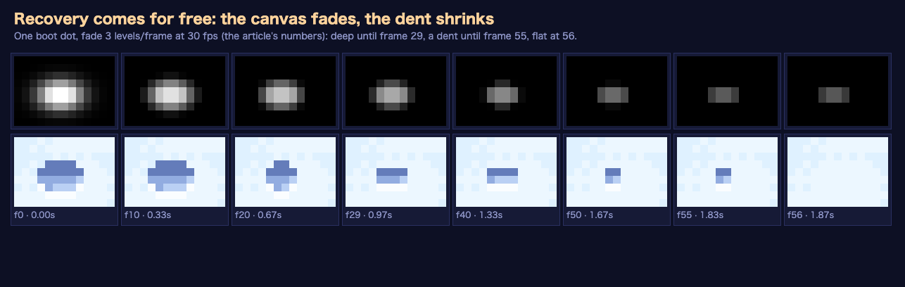

The canvas darkens by 3 each frame, so pixels fall below the thresholds from the outside in.
With no animation code at all, **the dent shrinks one pixel at a time and disappears**. With the article's numbers it is deep until frame 29, a dent until frame 55, and flat at 56.

### Snow on the boots

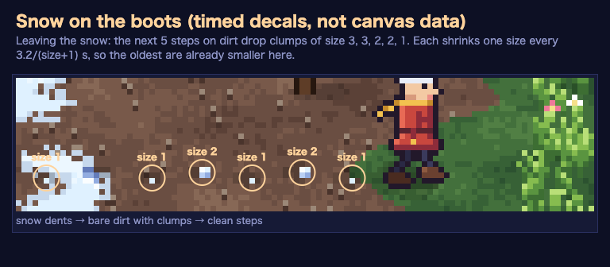

Stepping on snow sets a counter to 5. The next 5 steps on dirt or sand drop snow clumps of size 3, 3, 2, 2, 1.
Each clump shrinks one size every `3.2 / (size+1)` s. These are timed decals, not canvas data, and none are dropped on grass.

---

## 3. Grass: each tuft reads the canvas on the CPU

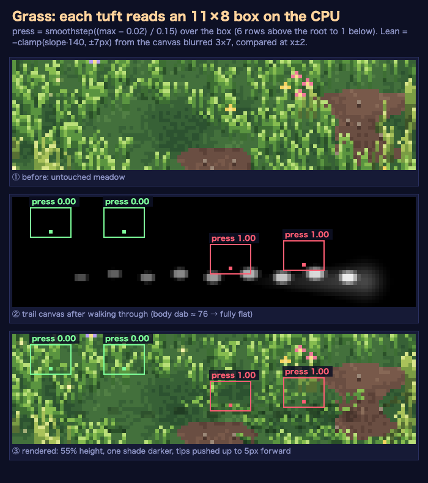

Grass is not a shader. It is about 2,000 Y-sorted tuft objects, and every frame each tuft:

1. **Pressure**: takes the max value `v` over an **11 px × 8 row** box around its root (6 rows above to 1 below, the boxes in the figure), then
   `press = smoothstep(clamp((v − 0.02) / 0.15))`. Level 44 or more is fully flat, and 5 or less stands.
2. **Lean**: compares the canvas, blurred over 3 rows × 7 columns, at ±2 px: `lean = −clamp(slope × 140, −7, 7)` px, so blades fall away from the centre of the trail.
3. **Drawing**: height × (1 − 0.45·press), so at most 55% of the height. Above press 0.5 the tuft is one shade darker, and the tips shift up to 5 px forward so it looks like it's lying down.

Characters and tufts share one Y-sort, so grass in front hides the feet.

### Springing back

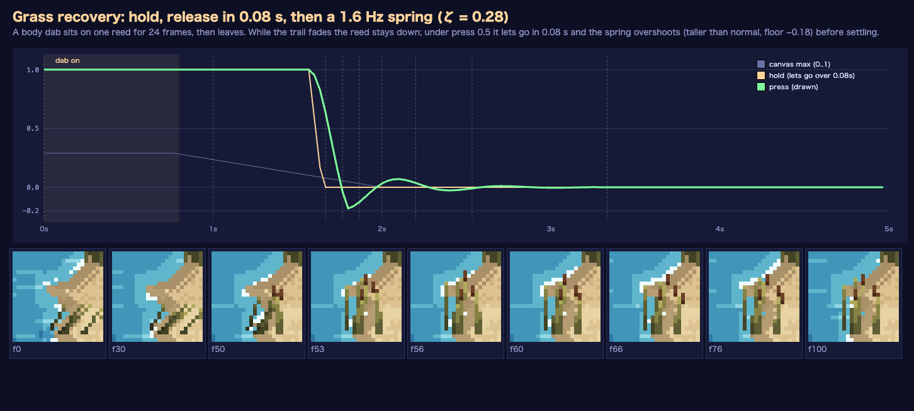

Measured on a single reed: a body dab sits on it for 24 frames, then leaves.

- While pressed, and while the trail fades, the reed is **held down**.
- Once press drops below 0.5, the hold **lets go over 0.08 s**.
- The drawn press follows a **1.6 Hz spring with damping ratio 0.28**. It overshoots to −0.18, so the reed **pops up a little taller than normal** before settling.

---

## 4. Water: a height field fed only by new paint

### One boot landing → one ring

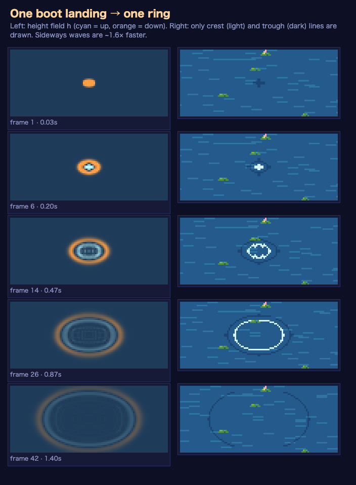

Water uses two `Float32Array`s (height `h`, velocity `v`) the same size as the canvas, scrolled the same way. Two substeps per frame:

```
v += 0.30 · lap_x(h) + 0.12 · lap_y(h)     // faster sideways (√(0.30/0.12) ≈ 1.6×)
v *= 0.982 · soak
h  = (h + 0.5 · v) · soak
```

Then 5% of a 3×3 box blur is blended in to remove fine noise.
Waves travel faster sideways to match ground that is squashed in depth by the top-down view, which is why the rings become wide ellipses.
`soak` comes from the distance to shore (a BFS at world generation): 0.92 at the shore, rising to 1.0 four pixels inland, so waves die where they reach land.

### Why new paint?

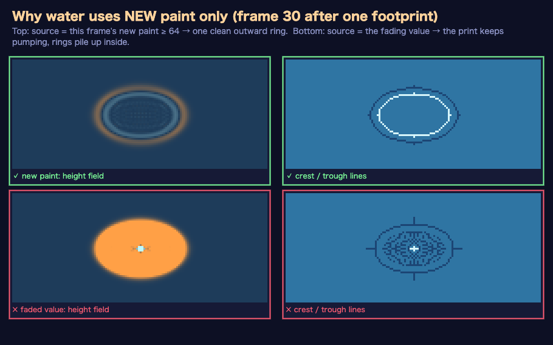

The only source is `newPaint ≥ 64` (a boot landing, or anything else painted heavily this frame), applied as `h −= newPaint / 255`.
In the bottom row, **the fading value itself is the source: the lingering footprint keeps pushing the water every frame**, and rings pile up inside each other.
The body dab adds only a little each frame even while walking, so it never becomes a source.

### Turning a height field into pixel-art lines

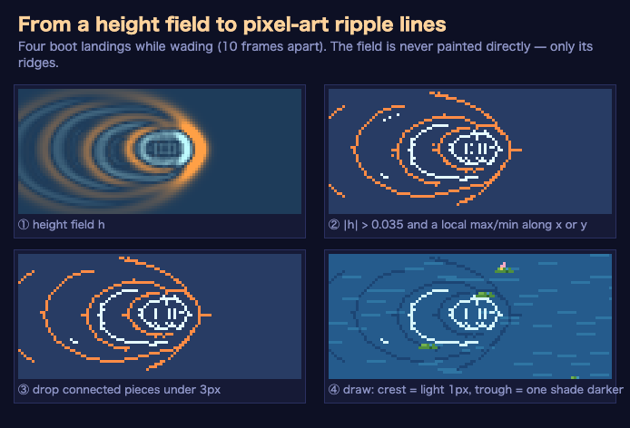

The height field is never painted directly:

1. `h > 0.035` and a local max along x or y → **crest line** (light 1 px). `h < −0.035` and a local min → **trough line** (one shade darker).
2. **Connected pieces under 3 px are dropped** (8-neighbour).
3. Only the remaining lines are drawn on the water.

The result is crisp pixel-art ripples instead of a blurry gradient.

### Wading

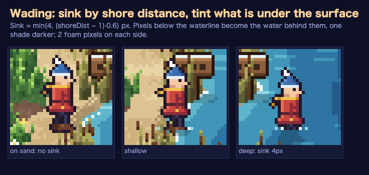

The character sinks up to 4 px depending on distance from shore. Sprite pixels below the surface are replaced with the water behind them, one shade darker, and two foam pixels are drawn on each side at the waterline.

---

## 5. Art: everything drawn in code

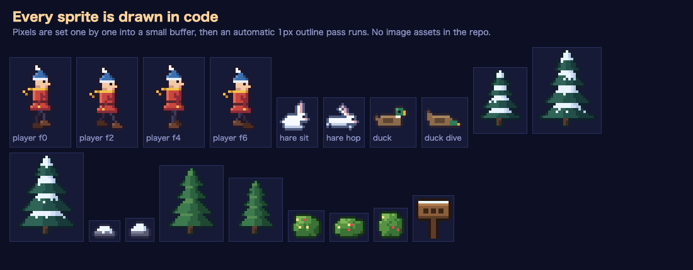

- **Sprites**: pixels are set one at a time into a small buffer, then an automatic 1 px outline pass runs. The player has an 8-frame walk, a bob, a fluttering scarf and blinking.
- **Sky**: a 7-stop gradient quantized to 18 bands and blended with a 4×4 Bayer dither, plus a sunset glow, twinkling stars and noise clouds shaded in 3 tones by their edges.
- **Background**: 4 parallax layers: far and near mountains (ridge noise, lit from the top left, snow lines), a conifer forest and a hedge row. Treetops near the snowfield carry snow.
- **Ground**: fBm noise for snow drifts, dirt and pebbles, patchy meadow, and dry and wet sand. The lake has 4 depth shades by distance from shore, drifting glints, the sunset reflection and shore foam.
- **Particles and weather**: snow puffs, splashes, dust, leaves, 3-layer snowfall and meadow fireflies.
- **Animals**: hares hop away from the player and leave Y-shaped tracks, ducks paddle (each stroke makes a small ripple) and sometimes dive, and fish jump now and then, making two ripples.

---

## Differences from the article

- The article targets Godot 4.6 (GPU shaders + SubViewports). Here everything runs on the CPU in JavaScript; the canvas is only about 40k pixels, so that is fast enough.
- The canvas follows the **camera** rather than the player and covers the whole view plus a margin. The article uses 120 px behind and 40 px ahead of the player.
- The default fade is 2 (the article uses 3). The slider can set it back to 3.
- Contact frames are 2 and 6 to match this demo's walk cycle (2 and 5 in the article's sprite sheet).
- The grass hold is read as "once press drops below 0.5, let go over 0.08 s", which makes the spring overshoot clearly visible.

## Regenerating the figures

Start `node tools/serve.js` (static files plus a `POST /save` endpoint that writes into `docs/`), open http://localhost:8765, and run this in the browser console:

```js
const s = document.createElement('script'); s.src = 'tools/figures.js'; document.body.append(s);
await FIG.all();
```

## License

MIT
