# 2D Trail Effects Lab — 雪・草・水のトレイル

**日本語** | [English](README.en.md)

▶ **ブラウザで遊ぶ: https://kumi0708.github.io/2d-trail-effects-lab/**

| ❄ 雪がへこむ | 🌾 草が倒れて起き上がる | 💧 着地した瞬間だけ波紋 |
|---|---|---|
| 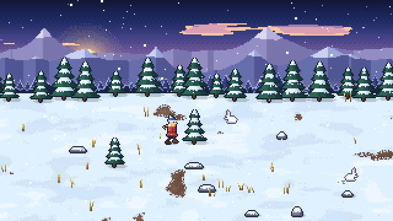 |  | 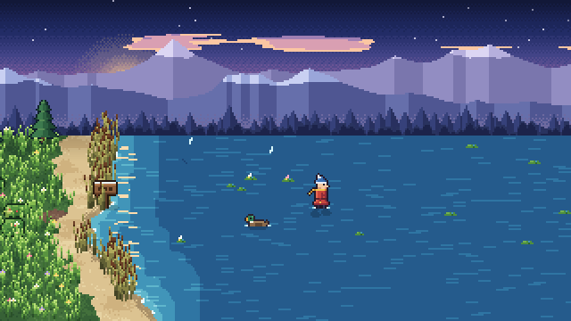 |

1枚の小さな **「トレイルキャンバス」**（8bit グレースケールのレンダーテクスチャ）だけで、雪・草・水の3つの地面エフェクトを同時に動かすデモです。
SpriteCook の記事 [*2D trail render texture: snow, grass, water*](https://www.spritecook.ai/blog/2d-trail-render-texture-snow-grass-water) の手法を、エンジンを使わない素の JavaScript（Canvas 2D + 自前のピクセルバッファ）で再実装しました。
地形・空・キャラクター・木・動物などの絵もすべてコードで生成しています（画像アセットなし）。

## 操作

| 入力 | 動作 |
|---|---|
| `←↑↓→` / `WASD` | 歩く（押すと自動歩行が OFF になります） |
| クリック / ドラッグ | 地面をつつく（その位置にスタンプを押す） |
| `P` | 自動歩行 ON/OFF |
| `M` | トレイルキャンバスを赤で地面に重ねて表示 |
| `F` | 降雪 ON/OFF |
| `R` | トレイル・波・草の状態をリセット |
| `1` `2` `3` | 雪原 / 草原 / 湖へワープ |
| スライダー | 1フレームあたりのフェード量（記事の値は 3、デモの初期値は 2） |

ページ下部には、実際のトレイルキャンバスと水の高さ場がリアルタイムで表示されます。
ビルドは不要で、`index.html` をブラウザで開くか、`python3 -m http.server` などで配信すれば動きます。

---

# 仕組み（図解）

> この README の図はすべて、本物のシミュレーションを [`tools/figures.js`](tools/figures.js) で動かして書き出したものです。

## 全体像

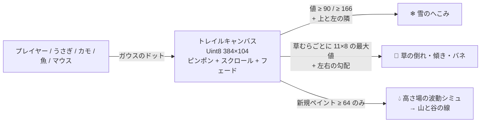

- 内部解像度 **320×180** のピクセルバッファに手で描き、CSS の `image-rendering: pixelated` で整数倍に拡大しています。
- シミュレーションは **固定 30fps**（記事の数値が 30fps 基準のため）。描画は `requestAnimationFrame`。
- コードは [`src/main.js`](src/main.js) の 1 ファイルです。

---

## 1. トレイルキャンバス — すべての元になる1枚の画像


ゲーム画面（上）の地面部分と、実際に毎フレーム更新しているキャンバス（下）です。
キャンバスは **画面幅 320px + 左右 32px の余白 = 384px**、高さは地面の 104px。1 ピクセル = ワールドの 1 ピクセルで、白いほど「強く踏まれた」場所です。

| 項目 | 内容 |
|---|---|
| 形式 | `Uint8Array`、値 0–255（GPU 版の RGBA8 の R チャンネルに相当） |
| ダブルバッファ | `trailA` / `trailB` をピンポン。GPU の「読んでいるテクスチャには書けない」制約と同じ構造 |
| フェード | 毎フレーム `v = max(v − FADE, 0)`。8bit なので整数レベルで減らす |
| 合成 | ガウスのスタンプを **max 合成**（明るい方が勝つ。足し算ではない） |
| 新規ペイント | `newPaint = 書き込み後 − フェード後` = 「このフレームで新しく塗られた量」。水だけが使う |

### カメラについていくスクロール

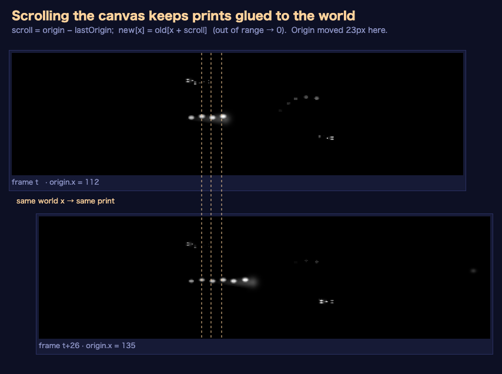

キャンバスはカメラと一緒に動きますが、足跡はワールドに張り付いていなければいけません。
そこで毎フレーム `scroll = 原点 − 前回の原点`（整数ピクセル）を求め、**新しいキャンバスは古いキャンバスの `x + scroll` を読みます**（範囲外は 0）。
上下2枚は 26 フレーム離れたキャンバスで、原点が 23px 動いていても、点線のとおり同じ足跡が同じワールド位置に残っています。

### 2種類のスタンプと、しきい値の使い分け

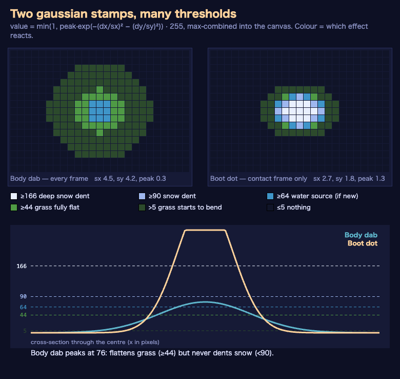

| スタンプ | タイミング | sx, sy | peak |
|---|---|---|---|
| 体（body dab） | **毎フレーム**、足元 + (向き×1, 1) | 4.5, 4.2 | 0.30 → 最大レベル 76 |
| ブーツ | 歩行アニメが接地フレームに**入った瞬間だけ** | 2.7, 1.8 | 1.3 → 中心がベタ白 |

同じキャンバスでも、効果ごとに見るしきい値が違うのがポイントです。
体のスタンプは最大 76 なので、**草は完全に倒す（44 以上）けれど雪はへこませない（90 未満）**。雪に溝を掘らず、足跡だけを残せます。

### 歩行アニメとブーツのスタンプ

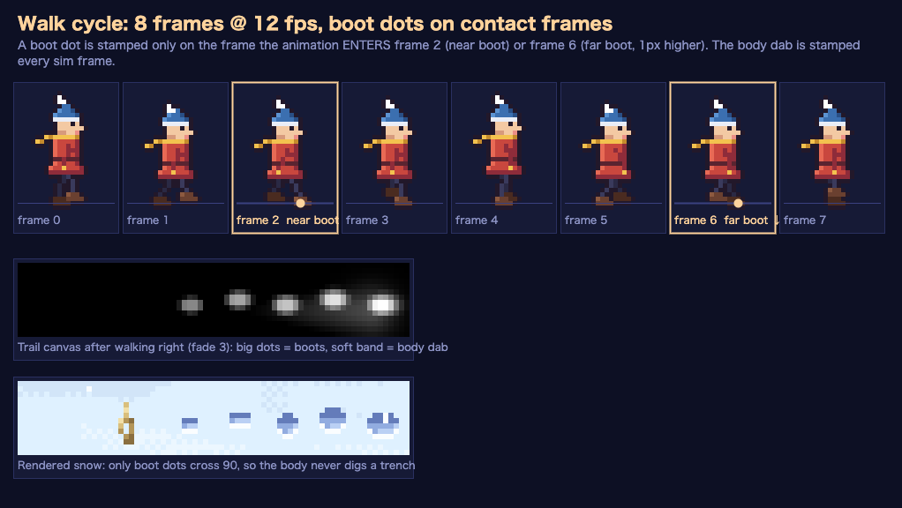

歩行は 8 フレーム / 12fps。フレーム 2（手前の足）と 6（奥の足、1px 上）に**入った瞬間**にブーツのドットを 1 回だけ押します。
下の2段は実際に歩かせた結果で、ブーツのドットだけが雪のしきい値 90 を超えて足跡になり、体のスタンプは薄い帯として残るだけです。

---

## 2. 雪 — しきい値と「上・左の隣」だけで立体に見せる


各ピクセルの色は、**自分の値・真上の値・左の値** だけで決まります（光源は左上）。

| 条件 | 色 |
|---|---|
| 値 ≥ 166 | DEEP `#92ace0`（深いへこみ） |
| 90 ≤ 値 < 166 | INSIDE `#bad0f4`（浅いへこみ） |
| へこみで、左がへこみでない | DEEP（左の壁の陰） |
| 深いへこみで、上は浅いへこみ | WALL `#647cba` |
| へこみで、上がへこみでない | WALL（上の壁 = いちばん濃い影） |
| へこみではないが、上がへこみ | LIP `#fafdff`（へこみの下に盛り上がった白い縁） |
| それ以外 | 雪 `#dff1ff`（＋ノイズの吹きだまりときらめき） |

図の②はデバッグ用の色で分類を見せたもの、③が本番のパレットです。右端の弱いドットは 166 に届かないので、深い部分がありません。

### 回復はタダで手に入る

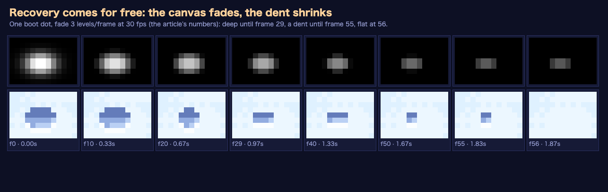

キャンバスが毎フレーム 3 ずつ暗くなるので、しきい値を下回ったピクセルから順に雪に戻ります。
特別なアニメーションを書かなくても、**へこみが外側から 1px ずつ縮んで消えていきます**（記事の数値で、深いのはフレーム 29 まで、へこみはフレーム 55 まで、56 で平ら）。

### ブーツについた雪

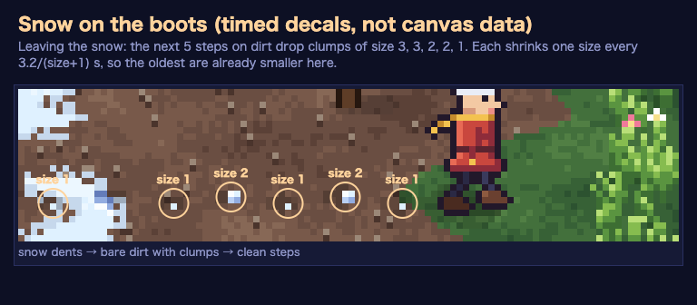

雪を踏むとカウンタが 5 になり、そのあと土や砂を踏んだ 5 歩ぶん、サイズ 3, 3, 2, 2, 1 の雪の塊を落とします。
塊は `3.2 / (size+1)` 秒ごとに 1 段階小さくなって消えます。これはキャンバスのデータではなく、時間で消えるデカールです（草の上では落としません）。

---

## 3. 草 — 草むらごとに CPU でキャンバスを読む


草はシェーダーではなく、Y ソートされた約 2,000 個の「草むら」オブジェクトです。各草むらは毎フレーム：

1. **押し込み量**：根元のまわり **幅 11px × 8 行**（根元の 6 行上〜1 行下、図の枠）の最大値 `v` を読み、
   `press = smoothstep(clamp((v − 0.02) / 0.15))`。レベル 44 以上で完全に倒れ、5 以下では立ったまま。
2. **傾き**：キャンバスを 3 行 × 7 列でぼかした値を左右 ±2px で比べ、`lean = −clamp(slope × 140, −7, 7)` px。踏まれた中心から外へ倒れます。
3. **描画**：高さ × (1 − 0.45·press)（最大で 55% の高さ）、press > 0.5 で 1 段暗く、葉先を最大 5px 前方へずらして「寝ている」形にします。

キャラクターと草むらは同じ Y ソートで描くので、手前の草が足元を隠します。

### バネで起き上がる


1 本の葦に体のスタンプを 24 フレーム当ててから離したときの実測値です。

- 踏まれている間と、トレイルが薄れていく間は **倒れたまま保持**（hold）。
- press が 0.5 を下回ったら保持を **0.08 秒で解放**。
- 見た目の press は **1.6Hz・減衰比 0.28 のバネ** で戻るので、一度 −0.18 まで行き過ぎて **元より少し高く伸び上がって** から落ち着きます。

---

## 4. 水 — 「新規ペイント」だけを波源にした高さ場

### ブーツ 1 回 → 輪が 1 つ

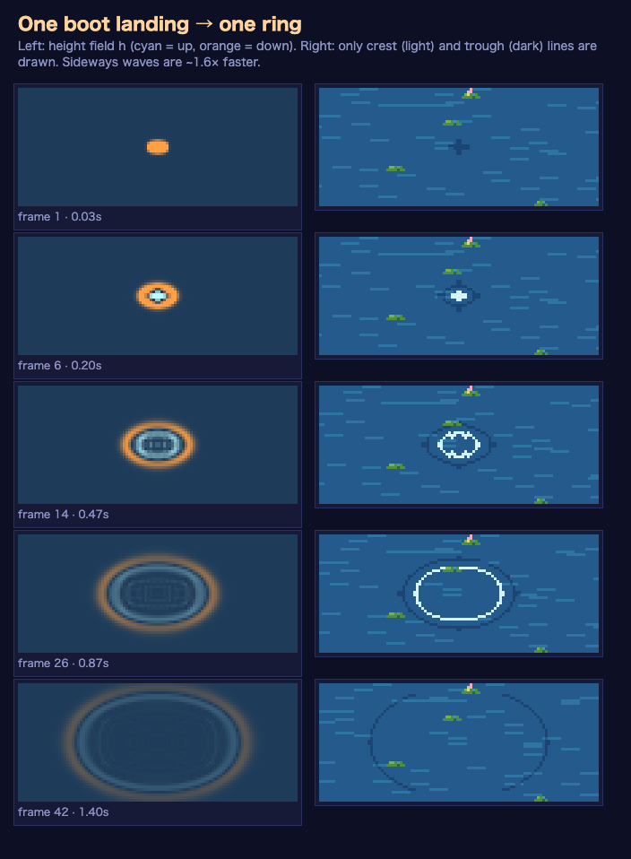

水はキャンバスと同じサイズ・同じスクロールの `Float32Array`（高さ `h` と速度 `v`）で計算します。1 フレームに 2 サブステップ：

```
v += 0.30 · lap_x(h) + 0.12 · lap_y(h)     // 横の方が速い（√(0.30/0.12) ≈ 1.6 倍）
v *= 0.982 · soak
h  = (h + 0.5 · v) · soak
```

そのあと 3×3 ボックスブラーを 5% 混ぜて細かいノイズを消します。
横方向を速くしているのは、見下ろし視点で奥行きが縮んでいる地面に合わせるためで、図のとおり輪が横長の楕円になります。
`soak` は岸からの距離（ワールド生成時に BFS で計算）で決まり、岸で 0.92、4px 内側で 1.0。岸に着いた波はそこで消えます。

### なぜ「新規ペイント」なのか


波源は `newPaint ≥ 64`（ブーツの着地のように、このフレームで大きく塗られた場所）だけで、`h −= newPaint / 255` とします。
下段のように **フェード中の値そのものを波源にすると、残った足跡が毎フレーム水を押し続け**、輪が内側に何重にも溜まってしまいます。
体のスタンプは歩いても 1 フレームの増分が小さいので、波源になりません。

### 高さ場をドット絵の線にする


高さ場そのものは塗りません。

1. `h > 0.035` かつ x か y 方向の極大 → **山の線**（明るい 1px）、`h < −0.035` かつ極小 → **谷の線**（1 段暗い）
2. 8 近傍でつながった **3px 未満の切れ端は捨てる**
3. 残った線だけを水の上に描く

これでぼやけたグラデーションではなく、ドット絵らしいくっきりした波紋になります。

### 水の中を歩く

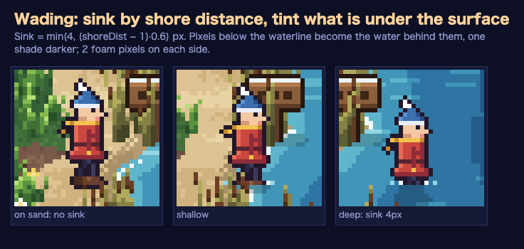

岸からの距離に応じて最大 4px 沈みます。水面より下のスプライトのピクセルは、後ろにある水の色を 1 段暗くした色に置き換え、水面の左右に 2px ずつ泡を描きます。

---

## 5. 絵づくり — すべてコードで描く

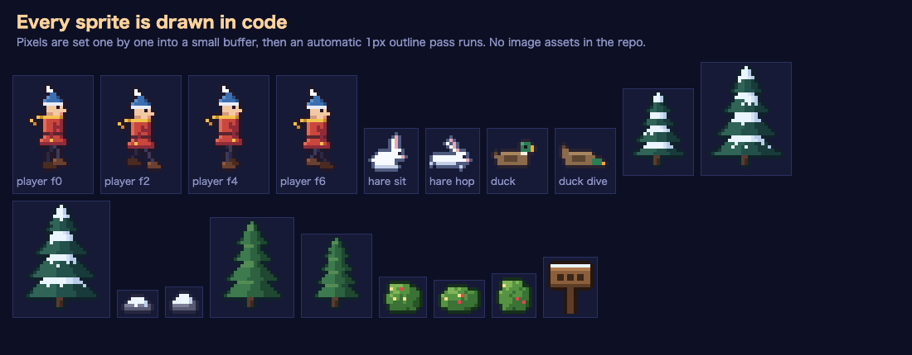

- **スプライト**：小さなバッファにピクセルを 1 つずつ置き、最後に自動で 1px のアウトラインを付けます。プレイヤーは 8 フレームの歩行、上下のボブ、なびくマフラー、まばたき付き。
- **空**：7 色のグラデーションを 18 段に量子化して 4×4 Bayer ディザでなじませ、夕日のグロー、瞬く星、ノイズから作った雲（上下の縁で 3 色に塗り分け）。
- **遠景**：遠い山・近い山（リッジノイズ、左上から光、雪線）、針葉樹の森、生け垣の 4 層パララックス。雪原の近くでは梢に雪が乗ります。
- **地面**：fBm ノイズで雪の吹きだまり、土と小石、草地のまだら、乾いた砂と濡れた砂。湖は岸からの距離で 4 段の深さ色、流れるきらめき、夕日の映り込み、波打ち際の泡。
- **パーティクルと天気**：雪けむり、水しぶき、土ぼこり、葉っぱ、3 層の降雪、草原のホタル。
- **動物**：うさぎはプレイヤーから跳ねて逃げて Y 字の足跡を残し、カモは水かきの小さな波を出しながら泳いで時々潜り、魚はときどき跳ねて 2 つの波紋を作ります。

---

## 記事との違い

- 記事は Godot 4.6（GPU シェーダー + SubViewport）向けですが、ここではすべて CPU 上の JavaScript で実装しています。キャンバスは約 4 万ピクセルと小さいので、CPU でも十分速く動きます。
- キャンバスはプレイヤーではなく **カメラ** についていき、画面全体と左右の余白を覆います（記事はプレイヤーの後ろ 120px・前 40px）。
- フェード量の初期値は 2 です（記事は 3）。スライダーで 3 に戻せます。
- 接地フレームは自作の歩行アニメに合わせて 2 と 6 にしています（記事のスプライトシートでは 2 と 5）。
- 草の保持は「press が 0.5 を下回ったら 0.08 秒で解放」と解釈しました。これでバネの行き過ぎがはっきり見えます。

## 図を作り直す

`node tools/serve.js`（静的配信 + `POST /save` で `docs/` に保存する小さなサーバー）を起動して http://localhost:8765 を開き、ブラウザのコンソールで実行します。

```js
const s = document.createElement('script'); s.src = 'tools/figures.js'; document.body.append(s);
await FIG.all();
```

## ライセンス

MIT
