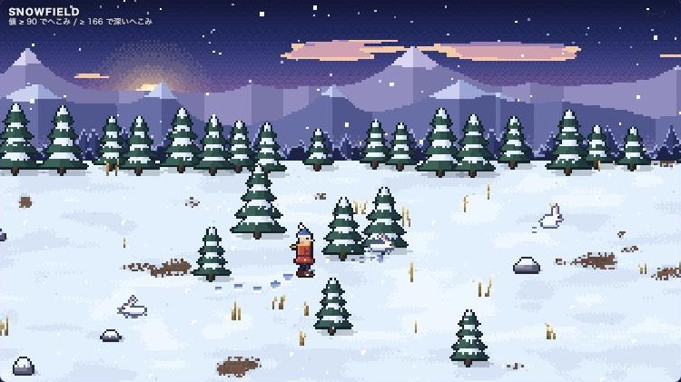
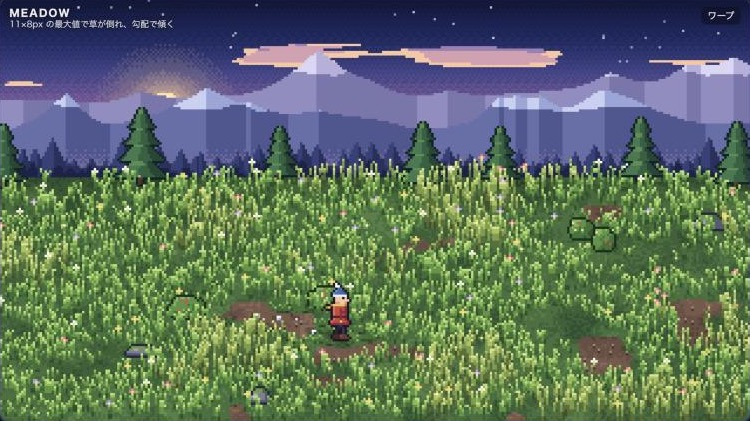
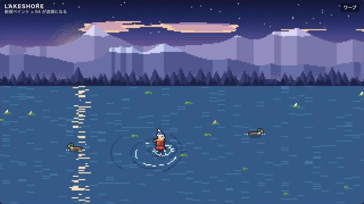

# 2D Trail Effects Lab — 雪・草・水のトレイル

**日本語** | [English](README.en.md)

▶ **ブラウザで遊ぶ: https://kumi0708.github.io/2d-trail-effects-lab/**

1枚の小さな「トレイルキャンバス」（8bit グレースケールのレンダーテクスチャ）だけを使って、

- ❄ **雪** … 足跡がピクセル単位でへこみ、光の当たる壁・影・白いリップが付く
- 🌾 **草** … 踏まれた草むらが倒れ、勾配の方向に傾き、バネで揺れ戻る
- 💧 **水** … 着地した瞬間だけ波紋が生まれ、異方性の波として広がり岸で消える

を同時に実現するデモです。SpriteCook の記事
[*2D trail render texture: snow, grass, water*](https://www.spritecook.ai/blog/2d-trail-render-texture-snow-grass-water)
の手法を、エンジンなしの素の JavaScript（Canvas 2D + 自前ピクセルバッファ）で再実装しました。
地形・空・キャラクター・木・動物などの絵はすべてコードで手続き的に生成しています（画像アセットなし）。

| 雪 | 草 | 水 |
|---|---|---|
|  |  |  |

## 操作

| 入力 | 動作 |
|---|---|
| `←↑↓→` / `WASD` | 歩く（押すと自動歩行が OFF になります） |
| クリック / ドラッグ | 地面をつつく（その位置にスタンプを押す） |
| `P` | 自動歩行 ON/OFF |
| `M` | トレイルキャンバスを赤で地面に重ねて表示 |
| `F` | 降雪 ON/OFF |
| `R` | トレイル・波・草の状態をリセット |
| `1` `2` `3` | 雪原 / 草原 / 湖へワープ |
| スライダー | 1フレームあたりのフェード量（記事の値は 3、デモの初期値は 2） |

ページ下部には、実際のトレイルキャンバス（384×104）と水の高さ場がリアルタイムで表示されます。

## ローカルで動かす

ビルド不要です。`index.html` をブラウザで直接開くか、任意の静的サーバーで配信してください。

```bash
python3 -m http.server 8000
```

---

## 技術解説

### 全体構成

```
 入力・AI ──▶ ドット(ガウス)のリスト ──▶ トレイルキャンバス (Uint8, 384×104, ピンポン)
                                              │
                    ┌─────────────────────────┼──────────────────────────┐
                    ▼                         ▼                          ▼
              雪: しきい値 + 隣接判定     草: 草むらごとに CPU で読む    水: 「新規ペイント」→ 波動シミュ
```

- 画面は **320×180** の内部解像度。`Uint32Array` のピクセルバッファに全部を手で描き、`putImageData` 後に CSS の `image-rendering: pixelated` で整数倍に拡大しています。
- シミュレーションは **固定 30fps**（`DT = 1/30`）。記事の数値（フェード量、寿命など）は 30fps 基準なので、それに合わせています。描画は `requestAnimationFrame`。
- ソースは [`src/main.js`](src/main.js) 1ファイルにまとまっています。

### 1. トレイルキャンバス（共通のデータ）

| 項目 | 内容 |
|---|---|
| 形式 | `Uint8Array`、1ピクセル = ワールドの1ピクセル、値 0–255 |
| サイズ | 384×104（画面幅 320 + 左右 32px ずつの余白 × 地面の高さ 104） |
| ダブルバッファ | `trailA` / `trailB` をピンポン。GPU 版の「読んでいるテクスチャに書けない」制約と同じ構造 |
| 追従 | 原点 = `カメラの整数x − 32`。毎フレーム `scroll = 原点 − 前回原点` を求め、新キャンバスは旧キャンバスの `x + scroll` を読む（範囲外は 0）。これをしないと足跡がプレイヤーと一緒に動いてしまう |
| フェード | `v = max(v − FADE, 0)`。8bit なので整数レベルで減らす |
| スタンプ | ガウス `min(1, peak · exp(−(dx/sx)² − (dy/sy)²))` を **max 合成**（明るい方が勝つ） |
| 新規ペイント | `newPaint = 書き込み後 − フェード後`。このフレームで「新たに」塗られた量。水だけが使う |

スタンプの種類：

| スタンプ | タイミング | 位置 | sx, sy | peak |
|---|---|---|---|---|
| 体（body dab） | 毎フレーム | 足元 + (向き×1, 1) | 4.5, 4.2 | 0.30（= レベル 76、雪のしきい値 90 未満） |
| ブーツ | 歩行アニメが接地フレームに **入った瞬間だけ** | 足元 + (向き×3, 0) / 奥の足は (向き×3, −1) | 2.7, 1.8 | 1.3（中心がベタ白になる） |
| うさぎ | 跳ねて着地した瞬間 | 後ろ足2つ + 前足1つ | 1.6, 0.9 など | 1.0–1.15 |
| カモ | 水かき（周期的）、潜る時 | 尾 / 頭の位置 | 1.6–2.0 | 0.42 / 0.95 |
| 魚 | 跳ねた時と着水時 | 魚の位置 | 2.0–2.3 | 0.9–1.0 |
| マウス | 押している間 | カーソル | 3.0, 2.4 | 1.3 |

体のスタンプは雪をへこませない（76 < 90）けれど、草を倒すには十分（44 以上で完全に倒れる）という絶妙な値になっています。
歩行アニメは 8 フレーム / 12fps で、接地フレームは 2 と 6 です。

### 2. 雪 — しきい値と隣接ピクセルだけで立体感を出す

地面の各ピクセルについて、そのピクセルと **上・左の隣** のトレイル値だけを見て色を決めます（光源は左上）。

| 条件 | 色 |
|---|---|
| 値 ≥ 166（深いへこみ） | DEEP `#92ace0` |
| 90 ≤ 値 < 166（浅いへこみ） | INSIDE `#bad0f4` |
| へこみで、左がへこみでない | DEEP（左の壁の陰） |
| 深いへこみで、上は浅いへこみだが深くない | WALL `#647cba` |
| へこみで、上がへこみでない | WALL（上の壁＝一番濃い影） |
| へこみでないが、上がへこみ | LIP `#fafdff`（へこみの下側に盛り上がった白い縁） |
| それ以外 | 雪のベース `#dff1ff`（＋ノイズの吹きだまり、きらめき） |

キャンバスがフェードすると値がしきい値を下回ったピクセルから順に元に戻るので、**へこみが外側から1ピクセルずつ縮んで消えていく** 回復アニメーションが自動的に得られます。
砂浜でも同じしきい値で足跡を描き（乾いた砂 / 濡れた砂で色を変える）、土の上では薄い靴跡になります。

**ブーツに付いた雪**：雪を踏むとカウンタが 5 にセットされ、その後に土・砂を踏んだ 5 歩ぶん、サイズ 3,3,2,2,1 の雪の塊を落とします。塊は `3.2 / (size+1)` 秒ごとに1段階ずつ小さくなって消えます（キャンバスのデータではなく、時間制のデカール）。草の上では落としません。

### 3. 草 — 草むらごとに CPU でキャンバスを読む

草はシェーダーではなく、Y ソートされた「草むら（tuft）」オブジェクトの集合です（約 2,000 個 + 葦 + 雪原の枯れ草）。各草むらは毎フレーム：

1. **押し込み量**：根元の周り **幅 11px × 8 行**（根元の 6 行上〜1 行下）の最大値 `v` を取り、
   `press = smoothstep(clamp((v − 0.02) / 0.15))`。レベル 44 以上で完全に倒れ、5 以下では立ったまま。
2. **傾き**：キャンバスを 3 行 × 7 列でぼかした値を左右 ±2px で比較し、
   `slope = (b(x+2) − b(x−2)) / 4`、`lean = −clamp(slope × 140, −7, 7)` px。踏まれた中心から外側へ倒れます。
3. **回復**：倒れる方向へは即座に追従、トレイルが消えると保持値が 0.08 秒で解放され、
   その後 **1.6Hz・減衰比 0.28 のバネ** で戻ります。少しオーバーシュートして一瞬だけ元より高く伸びる（下限 −0.18）ので「ぴょこっ」と起き上がって見えます。傾きも別のバネで戻ります。
4. **描画**：高さ × (1 − 0.45·press)（＝最大で 55% の高さ）、press > 0.5 で 1 段暗い色、葉先を最大 5px 前方へずらして「寝ている」形に。さらに常時の風の揺れを加算しています。

キャラクターと草むらは同じ Y ソートで描くので、手前の草が足元を隠します。

### 4. 水 — 「新規ペイント」だけを波源にした高さ場シミュレーション

水はトレイルキャンバスと同じサイズ・同じスクロールの `Float32Array` 2枚（高さ `h` と速度 `v`）で計算します。

1. **波源**：`newPaint ≥ 64`（= ブーツの着地など、そのフレームに大きく塗られたピクセル）だけ `h −= newPaint/255`。
   フェードしていく値そのものを使うと、残った足跡が毎フレーム波を出し続け、輪が内向きに縮んで見えてしまうため。
   体のスタンプは前進しても 1 フレームの増分が小さいので波源になりません。
2. **積分**（1 フレーム 2 サブステップ）
   ```
   v += 0.30 · lap_x(h) + 0.12 · lap_y(h)     // 横の方が速い（√(0.30/0.12) ≈ 1.6 倍）
   v *= 0.982 · soak
   h  = (h + 0.5 · v) · soak
   ```
   その後 3×3 ボックスブラーを 5% だけ混ぜて高周波ノイズを抑えます。横方向を速くしているのは、見下ろし視点で奥行きが圧縮されている地面に合わせるため。
3. **岸での減衰**：岸からの距離（ワールド生成時に BFS で計算）を使い、`soak` を岸で 0.92、4px 内側で 1.0 にします。
4. **描画**：高さ場そのものは塗らず、`h > 0.035` かつ x または y 方向の極大 → 明るい 1px の **山の線**、`h < −0.035` かつ極小 → 1 段暗い **谷の線** だけを描きます。
   8 近傍の連結成分を数えて 3px 未満の切れ端は捨てるので、ドット絵らしいくっきりした輪になります。
5. **水中を歩く**：岸からの距離に応じて最大 4px 沈み、水面下のスプライトは下の水の色を 1 段暗くした色に置き換え、水面の左右に 2px ずつ泡を描きます。

### 5. 絵づくり（すべて手続き生成）

- **空**：7 色のグラデーションを 18 段に量子化し、4×4 Bayer ディザで段差をなじませています。夕日のグロー、瞬く星、ノイズから作った雲（上下の縁で 3 色に塗り分け）。
- **遠景**：遠い山・近い山（リッジノイズ、左上光源で明暗、雪線）、針葉樹の森、生け垣の 4 層パララックス。雪原の近くでは森の梢に雪が乗ります。
- **地面**：fBm ノイズで雪の吹きだまり、土・小石、草地のまだら、乾いた砂と波打ち際の濡れた砂を生成。湖は岸からの距離で 4 段の深さ色、横に流れるきらめき、夕日の映り込み、波打ち際の泡。
- **スプライト**：プレイヤー（8 フレーム歩行、ボブ、なびくマフラー、まばたき）、うさぎ、カモ、魚、雪の積もった木、岩、低木、看板を、ピクセル単位のコードで描いて自動アウトラインを付けています。
- **パーティクル**：雪けむり・水しぶき・土ぼこり・葉っぱ、降雪（3 層の視差）、草原のホタル。
- **動物の AI**：うさぎはプレイヤーが近づくと跳ねて逃げ、Y 字の足跡を残します。カモはゆっくり泳ぎながら水かきの波を出し、時々潜ります。魚がときどき跳ねて 2 つの波紋を作ります。

### 記事との違い

- 記事は Godot 4.6（GPU のシェーダー + SubViewport）向けですが、ここではすべて CPU の JavaScript で実装しています。キャンバスが小さい（約 4 万ピクセル）ので CPU でも十分高速です。
- キャンバスはプレイヤーではなく **カメラ** に追従させ、画面全体＋余白を覆うようにしています（記事はプレイヤーの後方 120px・前方 40px）。
- フェード量の初期値を 2 にしています（記事は 3）。スライダーで 3 に戻せます。
- 接地フレームは自作の歩行アニメに合わせて 2 と 6 にしています（記事のスプライトシートでは 2 と 5）。

## ライセンス

MIT
